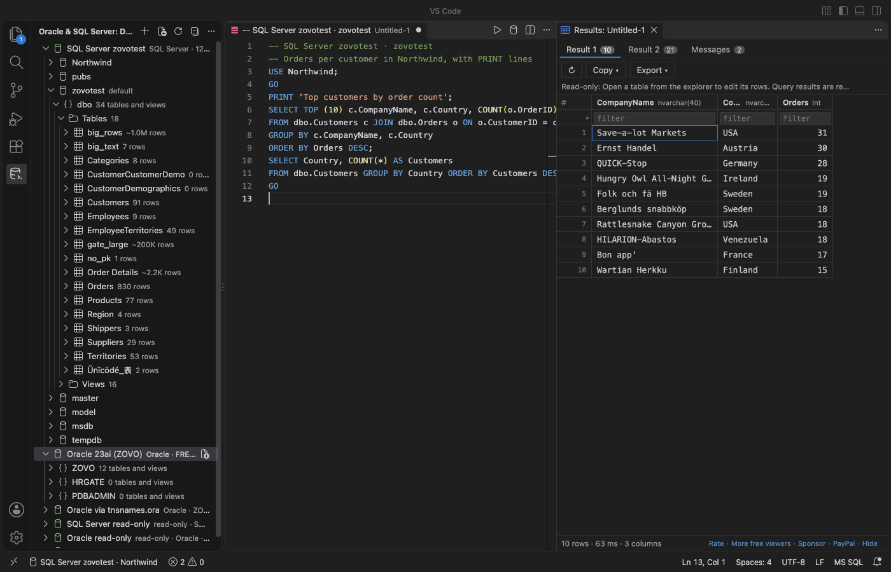
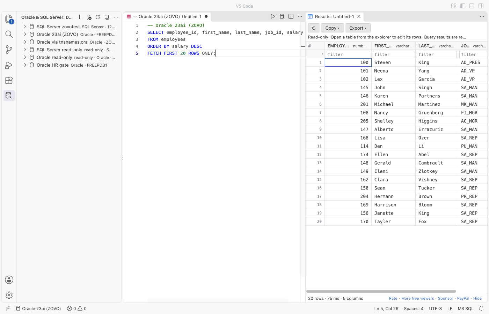

# Oracle SQL & SQL Server Query Client for VS Code

A free Oracle SQL client and SQL Server client (MSSQL, Azure SQL) in one extension. Run T-SQL and PLSQL with Ctrl+Enter, see `PRINT` and `DBMS_OUTPUT` lines, browse tables and procedures, cancel long queries and export millions of rows to CSV. It works in VS Code, Cursor and Windsurf. No sign-in, no account, no subscription.

Network: the extension connects only to the database servers you add, and only when you expand a connection or run a query. It sends no telemetry, makes no update check and calls no license server. It never runs a keep-alive or polling query. Passwords and tokens go to VS Code's secret storage, never to settings or logs.

## Why this one

Measured against complaints in recent reviews of other SQL Server and Oracle extensions on the Marketplace (dates are review dates). The numbers on the right come from the real-app test of this version, on VS Code 1.142.0 with SQL Server (Azure SQL Edge) and Oracle Database 23ai Free in local containers.

| Complaint in reviews | Measured here |
|---|---|
| "It takes 1 minute at every VSCode start to activate it" ([review, 2026-11-03](https://marketplace.visualstudio.com/items?itemName=Oracle.sql-developer&ssr=false#review-details)) and "This plug in always seem to take FOREVER to load" ([review, 2026-11-03](https://marketplace.visualstudio.com/items?itemName=ms-mssql.mssql&ssr=false#review-details)) | Activation took 30 ms (Developer: Show Running Extensions). The extension starts only when a `.sql` file or its view opens, and it opens no connection at startup. The drivers are pure JavaScript: no Java, no language server, no Oracle Client install. |
| "Query result grid's performance is poor. It freezes, if there are large text columns" ([review, 2026-09-03](https://marketplace.visualstudio.com/items?itemName=Oracle.sql-developer&ssr=false#review-details)) | A table with five 10 MB CLOB cells (Oracle) and five 10 MB `nvarchar(max)` cells (SQL Server) opened in 0.5 s (Oracle) and 4.1 s (SQL Server, which sends all 10 MB of each cell over the network first); the grid answered input 1 ms later. The grid gets a 2,000-character preview of each cell. A click opens the full value in an editor tab. |
| "Unstable. Can't hold a connection." ([review, 2026-10-24](https://marketplace.visualstudio.com/items?itemName=Oracle.sql-developer&ssr=false#review-details)) and "Impossible to restore connections to a database once lost" ([review, 2025-08-08](https://marketplace.visualstudio.com/items?itemName=Oracle.sql-developer&ssr=false#review-details)) | In the test, the database container was stopped during a query. The query ended with a clear "connection was lost" message. After the server came back, the next query reconnected by itself: it returned in 96 ms, with no click on Reconnect. |
| "I wasted a couple hours trying to get it give me a csv" ([review, 2026-10-24](https://marketplace.visualstudio.com/items?itemName=Oracle.sql-developer&ssr=false#review-details)) | Export streams every row to CSV, JSON or SQL INSERT. 1,000,000 rows: 2.2 s on SQL Server (47.3 MB CSV) and 4.0 s on Oracle (43.4 MB CSV), with the extension host using at most 111 MB more memory. |
| "There doesn't seem to be any indicator which database a SQL worksheet is connected" ([review, 2026-04-23](https://marketplace.visualstudio.com/items?itemName=Oracle.sql-developer&ssr=false#review-details)) | The status bar shows the connection, database and a lock for read-only connections for every `.sql` file. Click it to change. |
| "Tried using a custom path for tnsnames.ora ... with no success" ([review, 2025-05-28](https://marketplace.visualstudio.com/items?itemName=Oracle.sql-developer&ssr=false#review-details)) | Pick any folder that holds `tnsnames.ora` in the form (or use `TNS_ADMIN`). The aliases show in a list, and a file with a syntax error gets a message with the line number. |

## Features (free)

- SQL Server and Azure SQL through `tedious` (pure JavaScript):
  - SQL login, Windows login (NTLM, with a domain) and Azure AD access tokens.
  - Encrypt, strict (TDS 8.0) or off, plus "Trust the server certificate". Named instances.
  - Paste an ADO.NET string, a JDBC URL or `sqlserver://user@host:1433/db` to fill the form.
- Oracle Database through `node-oracledb` in Thin mode (pure JavaScript, no Oracle Instant Client):
  - Easy Connect (`host:1521/service`), SID, or a full `(DESCRIPTION=...)` string.
  - `tnsnames.ora` aliases from `TNS_ADMIN` or a folder you pick.
  - Wallet folders for Autonomous Database (`ewallet.pem`), and SYSDBA and the other admin roles.
- Database Explorer, loaded level by level:
  - SQL Server: databases, schemas, tables, views, procedures and functions.
  - Oracle: schemas, tables, views, procedures, functions and packages (invalid ones marked).
  - Columns with types and keys, indexes, and row counts from the statistics.
  - "Script as CREATE" for any table, view, procedure, function or package.
  - "New Query: SELECT TOP 100 / FETCH FIRST 100" on any table.
- Query editor for any `.sql` file:
  - Ctrl+Enter runs the statement or `GO` batch at the cursor, or the selection. Ctrl+Alt+Enter runs the whole file.
  - T-SQL: `GO` and `GO 5` split batches, so `DECLARE`, temp tables and `PRINT` behave as in other SQL Server tools.
  - Oracle: `;` ends SQL statements. PL/SQL blocks and `CREATE PROCEDURE`, `PACKAGE` or `TRIGGER` end at a line with `/`. Scripts copied from SQL*Plus keep working: `SET SERVEROUTPUT ON`, `PROMPT` and similar lines are handled.
  - Every result set gets a tab: a batch with 20 `SELECT`s, or a procedure that returns 20 results, shows 20 tabs.
  - The Messages tab shows `PRINT` lines, `DBMS_OUTPUT.PUT_LINE` output (on by default per session) and row counts.
  - An error underlines the right place in your SQL: the line of a T-SQL error, the column of an Oracle error, and the line and column of a PL/SQL compile error.
  - Autocomplete knows your tables, views, columns and aliases, plus T-SQL and Oracle keywords.
- Results grid: virtual scroll, the first 1,000 rows at once, more on scroll or Load more.
  - Sort and filter run on the server when not every row is loaded.
  - Copy as CSV, TSV, JSON or Markdown.
  - Large text, CLOB and binary cells show a preview. Click one to open the full value.
- Cancel stops the running statement on the server: a TDS attention for SQL Server, a break for Oracle.
- Export: CSV, JSON or SQL INSERT, for a result or a whole table, streamed to the file.
- Safety:
  - A read-only switch per connection, enforced by the server. Oracle opens the session read-only (23ai and later; older versions get a read-only transaction). SQL Server runs each batch in a transaction that is rolled back.
  - Obvious writes are refused before they are sent, with a clear message.
  - UPDATE or DELETE without WHERE, TRUNCATE and DROP ask before they run.
  - A 10-second connect timeout with a clear message, and a clear message for a wrong password, a refused port or an unknown service name.
- Edit rows of a table opened from the explorer when it has a primary key. You review the exact SQL first, and it runs in one transaction.
- Query history, kept on this computer.

## Zovo Pro

These tools are ready and free in this version: execution plan (SQL Server estimated showplan or Oracle `EXPLAIN PLAN`, as a tree with costs), schema compare between two connections, ER diagram saved as SVG, DDL export of a whole schema to one `.sql` file, and a saved query library. If they ever move to Zovo Pro, it will be a one-time price (USD 19 for every Zovo extension), with no ads and no nag. Everything in "Features (free)" stays free.

## Getting started

1. Open the "Oracle & SQL Server" view in the activity bar and click Add Connection.
2. Pick SQL Server or Oracle. Paste a connection string or fill in the form, then click Test connection. It shows how long the connection took.
3. Click New Query on the connection, type SQL and press Ctrl+Enter (Cmd+Enter on macOS).

The status bar shows which connection a `.sql` file runs on. Click it to change.

## Settings

| Setting | Default | What it does |
|---|---|---|
| `zovoOra.rowLimit` | 1000 | Rows read per query and per Load more |
| `zovoOra.maxLoadedRows` | 100000 | Most rows kept in one result (export has no limit) |
| `zovoOra.connectTimeoutSeconds` | 10 | Give up connecting after this many seconds |
| `zovoOra.oracleDbmsOutput` | true | Show DBMS_OUTPUT lines in Messages |
| `zovoOra.oracleAutoCommit` | true | Commit each Oracle statement when it succeeds |
| `zovoOra.confirmUnboundedWrites` | true | Ask before UPDATE or DELETE without WHERE, TRUNCATE or DROP |
| `zovoOra.history` | true | Keep a local query history |
| `zovoOra.showProFeatures` | true | Show the plan, compare, ER, DDL export and library commands |
| `zovoOra.askForRating` | true | Ask for a rating once, after 2 good sessions |
| `zovoOra.showSupportLinks` | true | Show the small support links under the results |

## Privacy

- Connections to the database hosts you add, and nothing else. No telemetry, no analytics, no update check, no license server.
- Passwords, access tokens and wallet passwords live in VS Code's secret storage.
- The query history and saved queries stay in VS Code's storage on this computer.

## Not supported yet

- Kerberos and Azure AD interactive sign-in for SQL Server. Use SQL login, NTLM or an access token.
- Oracle native network encryption without TLS, and Oracle Thick-mode features (for example LDAP naming). Thin mode covers Easy Connect, TNS aliases and wallets.

## Support Zovo

Zovo extensions are free, with no ads and no tracking. They are made by [theluckystrike](https://github.com/theluckystrike) on GitHub. If this one saves you time, you can support the work:

- [Sponsor on GitHub](https://github.com/sponsors/theluckystrike)
- [PayPal](https://www.paypal.com/paypalme/najzzz)
- [Follow theluckystrike on GitHub](https://github.com/theluckystrike)

## More tools by Zovo

- [Postgres & MySQL Query Client - SQL Database Tool](https://marketplace.visualstudio.com/items?itemName=zovo.zovo-sql-client) connects to PostgreSQL, MySQL, MariaDB and SQLite, with free row editing and streamed export.
- [SQLite Viewer & SQLite3 DB File Browser, Database Explorer](https://marketplace.visualstudio.com/items?itemName=zovo.sqlite-table-viewer) browses SQLite tables read-only and runs SELECT queries.
- [XLSX Viewer & CSV Preview for Excel, XLS & Parquet](https://marketplace.visualstudio.com/items?itemName=zovo.table-viewer-vscode) opens CSV, TSV, Excel and Parquet files as a sortable, filterable table.
- [Large JSON Viewer, JSON Browser & JSON Tree](https://marketplace.visualstudio.com/items?itemName=zovo.zovo-json-tree-viewer) shows large JSON files as a searchable tree, copies JSONPath and turns arrays of objects into a table.
- [JSONL Viewer, Large JSONL Table & NDJSON Viewer](https://marketplace.visualstudio.com/items?itemName=zovo.zovo-jsonl-viewer) opens JSONL and NDJSON files as a table, as records or as a chat view.
- [Avro Viewer, Apache Arrow Viewer & Feather Viewer](https://marketplace.visualstudio.com/items?itemName=zovo.arrow-avro-viewer) opens Avro, Arrow and Feather files as a paged table.

See [all Zovo extensions on the Marketplace](https://marketplace.visualstudio.com/publishers/zovo).

## License

MIT. Third-party packages and their licenses are listed in [THIRD-PARTY-NOTICES.md](THIRD-PARTY-NOTICES.md).

## More from zovo

- [All free zovo VS Code extensions](https://marketplace.visualstudio.com/publishers/zovo) — file viewers, database clients, formatters. Offline, no telemetry, no sign-up.
- [Full MCP server catalogue](https://theluckystrike.github.io/mcp/) — local-first MCP servers for back-office work: invoices, VAT, PDFs, spreadsheets, payroll.
- [Hosted no-install MCP endpoints](https://mcp.zovo.one) — paste a URL in Claude / Cursor, nothing to install.
